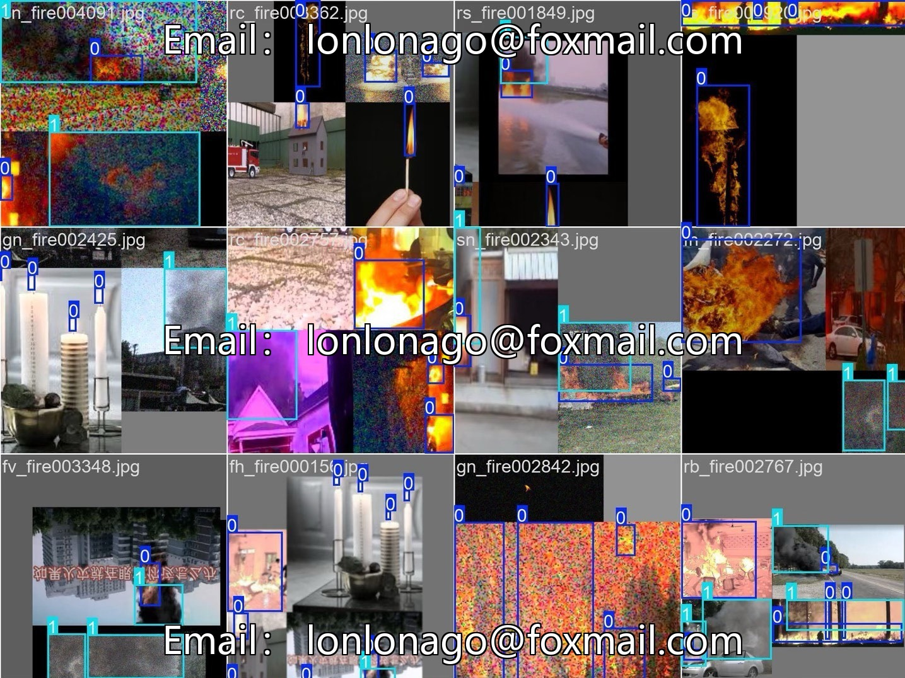
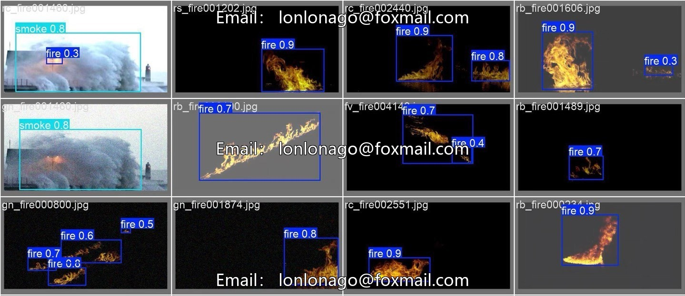

# YOLOv11 Fire Smoke Detection System

## Body

YOLOv11 Fire Smoke Detection System - Deep Learning Deployment
Project Overview
This project implements real-time detection and recognition of fires and smoke using the YOLOv11 object detection model. It can analyze video streams frame by frame, precisely locate flames and smoke targets, and trigger alarms. Suitable for various scenarios such as security monitoring, industrial inspection, drone patrols, etc., it provides a trained model, a visual operation interface, and a complete dataset. It is ready to be deployed and used out of the box, balancing detection accuracy with real-time performance.
Dataset Description

The project employs a multi-source fireworks dataset for training, covering various scenarios and environmental characteristics to ensure the model's generalization capability.
Public fireworks dataset: FASDD standard fireworks dataset, providing basic fireworks feature samples.
Professional high-definition dataset: FireSmoke-special, high-quality and high-resolution fireworks images.
Surveillance scenario dataset: FireSmoke-Surveillance, aligned with actual surveillance application scenarios in security.
Detection categories: Two core targets of flames and smoke, data covering indoors and outdoors, distant and close views, different lighting conditions.
Model Training
Training framework: Based on the official YOLOv11 framework, adapted for the task of fireworks detection.

Training Configuration: Optimize hyperparameters and employ data augmentation strategies to enhance robustness.
Training Rounds: A total of 300 training epochs are conducted, with the model converging stably.
Training Outcomes: The detection accuracy and recall rates are outstanding, meeting the mAP50 and mAP50-95 metrics, which can meet the rapid recognition needs in practical scenarios.
System Architecture
The entire system is divided into three core modules to achieve full-process fire monitoring.
Image Acquisition: Real-time video streams are obtained through surveillance cameras, drone cameras, etc.
Detection and Alarm: The YOLOv11 model performs inference frame by frame, triggering an alarm immediately after identifying flames / smoke.
Data Push: The detection results are synchronized to management personnel via SMS, APP push notifications, etc.
Core Features

Real-time video stream fireworks detection, low latency, high accuracy
Fire and smoke dual target precise positioning and confidence output
Target auto-alarm detected, suitable for security scene.
Friendly visual UI interface, simple and intuitive operation.
Supports multi-source input from cameras, local videos, and images.
Capable of carrying drones for complex area fire inspection.
Application scenarios
Public places: shopping malls, schools, subway stations, and other areas with high population density.
Industrial scene: Factory workshops, warehouses, power facilities and other fire-prone areas.
Civil scene: Residential communities, office buildings, high-rise building security monitoring.
Special Scenario: Drone-mounted inspection of forests and remote areas for fire hazards.
Optimization direction
Expand multi-scene dataset to further enhance model robustness

Continuously fine-tune model parameters to reduce false positives and missed detections.
Optimize inference speed to adapt to low computational power deployment on edge devices.
Upgrade interface interaction for enhanced usability.

## Images

## Payment

Here is a pay link on Stripe ( https://buy.stripe.com/3cs8yP7sY87d0vu9AB ). Please contact me lonlonago@foxmail.com after funding $89, and I will send you a complete data files , thank you!

